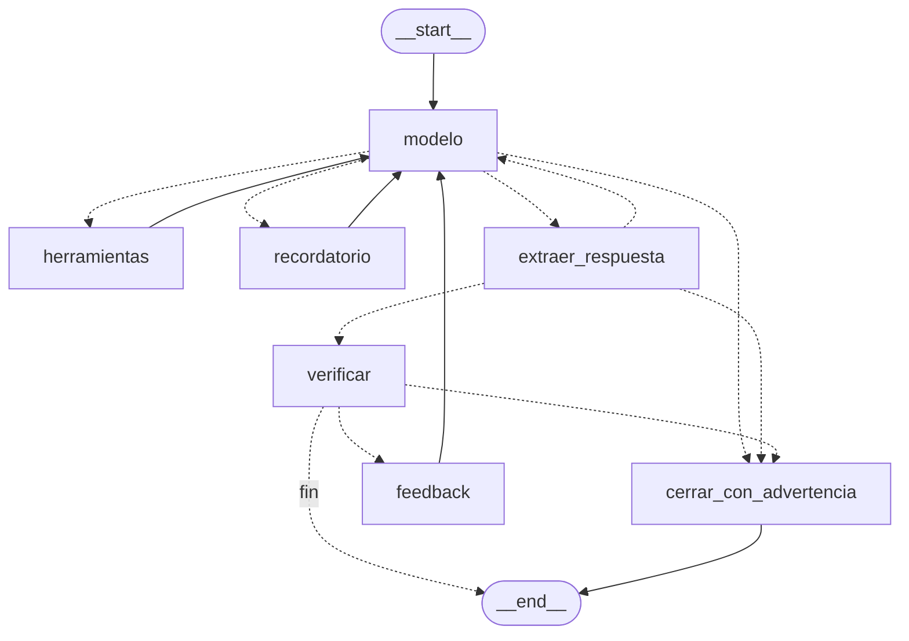
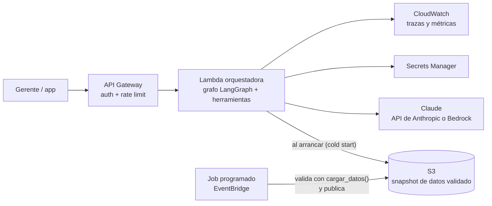

# Agente Café Tostadero

Asistente en español para el gerente regional de Café Tostadero: responde preguntas sobre pedidos,
quejas, sucursales y capacitaciones, y recomienda qué sucursales visitar. Prueba técnica de Airbag
(ML Engineer). Lo escribí en Python con LangGraph, DuckDB y pandas.

## Cómo correrlo (macOS)

Son cuatro pasos. Los dos primeros no necesitan clave ni red; el 3 y el 4 llaman al modelo.

### 1. Setup (obligatorio)

Requisitos: [uv](https://docs.astral.sh/uv/) y, solo para los pasos 3 y 4, una clave de la API de
Anthropic. No hace falta instalar Python: uv baja Python 3.11 si no está.

```bash
brew install uv                           # o: curl -LsSf https://astral.sh/uv/install.sh | sh
uv --version                              # comprobar que quedó instalado

git clone https://github.com/Augustorcrc/prueba-tecnica-airbag.git
cd prueba-tecnica-airbag
uv sync                                   # crea .venv con las versiones exactas de uv.lock
cp .env.example .env                      # y completar ANTHROPIC_API_KEY
```

En `.env`, la clave va sin comillas (`ANTHROPIC_API_KEY=sk-ant-...`). La clave se lee solo de
`ANTHROPIC_API_KEY` (variable de entorno o `.env`, que está en `.gitignore`); si falta, el CLI dice qué
variable exportar. Variables opcionales: `MODELO_LLM`, `MODELO_JUEZ` y `DATOS_DIR`.

### 2. Tests (sin clave ni red)

```bash
make test                                 # suite offline con un modelo falso
```

Tarda unos 10 segundos y debería terminar con **566 passed, 25 skipped**. Si da eso, el setup quedó bien.
Los 25 salteados son los que llaman al modelo real.

Opcionales:

```bash
make lint                                 # ruff
make test-clave                           # los 25 tests contra el modelo real (necesita clave, gasta créditos)
```

### 3. Probar el agente (con clave)

Una pregunta suelta:

```bash
make ask Q="¿Cuántas quejas hubo en total?"
make ask Q="¿Qué sucursales debería visitar esta semana?"   # pide recomendaciones: devuelve solo JSON
```

`make ask` es lo mismo que `uv run python main.py "pregunta"`.

Para ver la salida sin correr nada, hay dos ejemplos estáticos en `reportes/`:
`ejemplo_recomendaciones.json` (la respuesta a "¿Qué sucursales debería visitar esta semana?") y
`ejemplo_evaluacion.md` (un `make eval` con 1 repetición). El resto de `reportes/` se genera en cada
corrida y no se versiona.

**Evals.** Corren el agente sobre un conjunto de preguntas con respuesta esperada y comparan:

```bash
make eval                                 # preguntas de ejemplo (10) + propias (6), 3 repeticiones
make eval REPS=1                          # una sola repetición: más rápido y más barato
make eval PARALELO=1                      # secuencial (por defecto corre 3 corridas a la vez)
make eval-robustez                        # paráfrasis y preguntas adversariales (34)
```

- Imprime una tabla por pregunta y deja el reporte en `reportes/reporte.md` y `reportes/reporte.json`,
  más una copia con fecha y hora. El de robustez queda en `reportes/robustez/`.
- Una pregunta cuenta como acertada si acierta en la mayoría de las repeticiones.
- Corre 3 corridas a la vez (`PARALELO`). Si la clave tiene un límite de tasa bajo, el eval reintenta los
  429 con backoff; si aparecen muchos, conviene `PARALELO=1`.
- **Costo estimado en la API de Anthropic** (se cobra a la cuenta de la clave): unos USD 0,05–0,08 por
  pregunta con Sonnet 5.5, más centavos del juez (Haiku 5.5). `make eval` son 48 corridas (16 × 3), unos
  USD 2,5–4; `make eval-robustez` son 102 (34 × 3), unos USD 5–8. Es una estimación previa: ver
  [Costo y latencia](#costo-y-latencia).

Para más control, el eval se corre directo:

```bash
uv run python -m eval.evaluar eval/preguntas_ejemplo.jsonl eval/preguntas_propias.jsonl \
  --repeticiones 3 --salida reportes/ [--sin-juez] [--paralelo N] [--umbral 0.8]
```

`--sin-juez` no usa el modelo juez (las respuestas de texto largo fallan), `--paralelo` corre varias
preguntas a la vez y `--umbral` hace que el proceso salga con error si la tasa de aciertos queda por
debajo (pensado para CI).

### 4. Modo chat (opcional, con clave)

```bash
make chat                                 # o: uv run python main.py --chat [--traza]
```

Abre una conversación con memoria: "¿cuántas quejas tuvo el Sur en febrero?" y después "¿y en marzo?".
Comandos: `/nuevo` borra la memoria y `/salir` (o Ctrl+D) termina. Cada turno usa el mismo agente que una
pregunta suelta, con dos agregados (`agente/chat.py`):
- el modelo ve las últimas 6 preguntas y respuestas (solo el texto final);
- el verificador también acepta cifras que salieron de herramientas en turnos anteriores.

La memoria dura lo que dura la sesión. El eval y `make ask` no usan este modo: tratan cada pregunta por
separado.

### En Windows

Los comandos de arriba son de macOS y Linux. El código no depende del sistema operativo, y la CI corre
los tests offline en Linux y en Windows, pero `make` no viene instalado en Windows. Hay tres opciones:

- **WSL2 (recomendada):** dentro de WSL todo este README funciona tal cual.
- **Docker Desktop:** ver la sección siguiente.
- **Nativo, en PowerShell:** se instala uv y se corren los comandos sin `make`.

```powershell
winget install astral-sh.uv               # o: powershell -ExecutionPolicy ByPass -c "irm https://astral.sh/uv/install.ps1 | iex"
git clone https://github.com/Augustorcrc/prueba-tecnica-airbag.git
cd prueba-tecnica-airbag
uv sync
Copy-Item .env.example .env               # y completar ANTHROPIC_API_KEY
$env:PYTHONUTF8 = "1"                     # salida en UTF-8 aunque se redirija a un archivo
```

| Con make | En PowerShell |
|---|---|
| `make test` | `uv run python -m pytest` |
| `make test-clave` | `$env:PRUEBAS_CON_CLAVE = "1"; uv run python -m pytest -m requiere_clave` |
| `make ask Q="..."` | `uv run python main.py "..."` |
| `make eval` | `uv run python -m eval.evaluar eval/preguntas_ejemplo.jsonl eval/preguntas_propias.jsonl --repeticiones 3 --paralelo 3 --salida reportes/` |
| `make eval-robustez` | `uv run python -m eval.evaluar eval/preguntas_robustez.jsonl --repeticiones 3 --paralelo 3 --salida reportes/robustez/` |
| `make chat` | `uv run python main.py --chat` |

`PYTHONUTF8` evita un error de codificación con los acentos y la advertencia "⚠️" cuando la salida no va
a la consola. `$env:` vale solo para esa ventana de PowerShell.

### Con Docker (alternativa)

La imagen instala exactamente las versiones de `uv.lock` (`uv sync --frozen`), corre como usuario sin
privilegios y recibe la clave por variable de entorno (nunca queda dentro de la imagen).

```bash
make docker-test                          # build de la etapa de tests: corre la suite offline
make docker-build                         # imagen final
make docker-ask Q="¿Qué sucursales debería visitar esta semana?"   # usa --env-file .env
make docker-eval REPS=1                   # deja el reporte en ./reportes
```

La clave va sin comillas en `.env` porque `docker --env-file` no las saca.

## Estructura del repo

```
agente/        capa de datos, herramientas, SQL seguro, grafo, nodos, prompts, verificador, recomendaciones
datos/         CSV de entrada (copia de los provistos por Airbag)
eval/          evaluar.py, comparadores, juez, preguntas de ejemplo y propias
oraculo/       recálculo independiente de las respuestas esperadas (pandas puro)
tests/         tests offline (modelo falso, sin red)
docs/          grafo.mmd (diagrama del grafo) y curacion_datos.md (limpieza y transformaciones)
main.py        CLI
``` 

## Qué encontré en los datos y cómo lo traté

El detalle completo de la curación (dónde viven los datos, cada validación y transformación con su
impacto medido, y cómo se controla) está en [`docs/curacion_datos.md`](docs/curacion_datos.md).

**Cómo se calcula la tasa de quejas.** Casi todas las preguntas importantes comparan sucursales, regiones
o periodos con volúmenes muy distintos: "¿qué sucursal está peor?" o "¿funcionó la capacitación?". Para
eso hace falta una medida que no dependa del tamaño. El conteo de quejas no sirve, porque una sucursal
con el doble de pedidos tiene más quejas aunque atienda igual de bien. Por eso defino:

Tasa de quejas = quejas / pedidos × 1.000, como ratio de sumas sobre el recorte pedido (región, sucursal, mes,
etc.), nunca como promedio de tasas de quejas diarias o por sucursal. Con el ratio de sumas cada pedido pesa lo
mismo. Un promedio de tasas de quejas haría pesar igual un día o una sucursal con pocos pedidos, que dan tasas de quejas
extremas, que una sucursal grande.

Numerador y denominador cubren los mismos días: si un día tiene el dato de pedidos inválido, salen del
cálculo sus pedidos y también sus quejas, porque ese día no tiene un denominador confiable. Por eso un **conteo** de quejas ("¿cuántas hubo?") puede
incluir quejas que la **tasa de quejas** no usa; las herramientas lo informan en `quejas_excluidas`. La regla está
en una única función, `tasa_emparejada()` (`agente/datos.py`), y se detalla en la sección 3.5 de
`docs/curacion_datos.md`.

Resumen:

| Problema | Tratamiento | Por qué importa |
|---|---|---|
| 199 quejas duplicadas por `queja_id` | Deduplico (6.845 → 6.646) | Inflan los conteos y las tasas de quejas, y cambian el ranking por tasa de quejas de febrero |
| 8 filas de pedidos inválidos (5 con 99999, 3 negativos) | `pedidos_validos` = NULL; el día queda fuera de sumas y tasas de quejas | Con los crudos el total sube 15%, cambia el día de la semana con más pedidos y la sucursal top de la semana del 5 de enero |
| 7 quejas caen en esos días inválidos | Cuentan en los conteos, pero no en el numerador de las tasas de quejas | Numerador y denominador sobre los mismos días. Mantenerlas cambia la tasa de quejas 0,02–0,07 en 8 sucursales |
| 6 sucursales nuevas (abiertas el 16 y 17 de marzo, 13–14 días) | Fuera de los rankings por tasa de quejas (regla de 28 días abiertas), pero las menciono en el texto | Con pocos días la tasa de quejas es puro ruido |
| Capacitación: en el Norte se eligió al azar qué sucursales capacitar; en el resto, las de peor desempeño | Mido el efecto solo en el Norte: **-0,29 quejas cada 1.000 pedidos (~15% menos)**. Ver [Efecto de la capacitación](#efecto-de-la-capacitación) | Comparar capacitadas contra no capacitadas da una conclusión equivocada |
| S082 no tiene quejas (abrió el 17 de marzo) | Tasa de quejas 0, no NULL; queda fuera de los rankings por tasa de quejas como el resto de las nuevas | Evita leerla como "la mejor sucursal" sin contexto |

Periodo: 2026-01-05 (lunes) a 2026-03-29 (domingo), 12 semanas.

### Efecto de la capacitación

El 9 de febrero se capacitaron 36 sucursales. La pregunta es si eso bajó las quejas.

**Por qué no alcanza con comparar.** En Centro, Costa y Sur se capacitó a las sucursales que peor estaban
(3,49 quejas cada 1.000 pedidos, contra 1,91 de las no capacitadas). Una sucursal que tuvo un periodo malo
suele mejorar sola después, porque parte de lo malo fue mala suerte. Por eso las dos lecturas directas
engañan:
- Antes contra después de esas sucursales: bajan 1,25, pero no se sabe cuánto de eso fue la capacitación
  y cuánto habrían mejorado igual.
- Capacitadas contra no capacitadas después del 9 de febrero: las capacitadas siguen un poco peor (1,97
  contra 1,93), lo que hace parecer que la capacitación no sirvió. Pero arrancaron mucho peor.

**Cómo lo medí.** En el Norte, las 15 sucursales a capacitar se eligieron al azar, así que las no
capacitadas del Norte son una referencia justa de lo que habría pasado sin capacitación:

| Norte | Antes | Después | Cambio |
|---|---|---|---|
| Capacitadas (al azar) | 2,15 | 1,61 | -0,54 |
| No capacitadas | 2,17 | 1,91 | -0,25 |

Las no capacitadas también bajaron (-0,25), por algo que afectó a todo el Norte. El efecto de la
capacitación es la diferencia entre las dos bajas: -0,54 − (-0,25) = **-0,29 quejas cada 1.000 pedidos**.
Sin la capacitación, las capacitadas habrían terminado en 2,15 − 0,25 = 1,90. Terminaron en 1,61: **un
15% menos**. A este método se lo llama diferencia en diferencias.

Detalles:
- Quejas cada 1.000 pedidos calculadas como ratio de sumas por grupo. Promediando por sucursal, el
  efecto da -0,34.
- Antes: del 5 de enero al 8 de febrero. Después: del 9 de febrero al 29 de marzo. Solo entran las
  sucursales con el periodo completo.
- El agente lo responde con la herramienta `efecto_capacitacion`, que devuelve la tabla, el efecto y la
  advertencia sobre por qué solo el Norte permite medirlo.

## Decisiones de diseño

**Capa de datos única, en memoria** (`agente/datos.py`). En cada arranque, una sola función determinística,
`cargar_datos()`, lee, valida y limpia los CSV, y deja los datos limpios en pandas y en vistas de DuckDB en
memoria. Todo lo demás consume esa capa; el LLM nunca ve los CSV. Lo elegí así, y no un dataset curado en
disco, por estos motivos:
- Son ~17k filas y la carga tarda menos de 2 segundos. Guardar un intermedio no ahorra tiempo y suma el
  riesgo de que quede desincronizado del código.
- Los CSV no se modifican nunca y todo se reconstruye desde ellos: lo que documenta
  `docs/curacion_datos.md` es exactamente lo que se ejecuta.
- Las filas con problemas se marcan, no se borran ni se imputan. El valor crudo queda para auditar y no se
  inventan pedidos.
- Si los datos cambian (`DATOS_DIR`), las validaciones cortan la carga y muestran ejemplos de las filas que
  fallan, en vez de devolver cifras mal sin avisar.
- Es una decisión para esta escala. En producción, la curación pasa a un job que publica snapshots
  validados (ver [Cómo lo serviría en producción](#cómo-lo-serviría-en-producción)).

**Herramientas tipadas y genéricas** (`agente/herramientas.py`). En vez de una herramienta por pregunta,
un catálogo chico que se combina:

| Herramienta | Para qué |
|---|---|
| `info_datos` | Periodo, regiones, categorías, reglas de limpieza |
| `buscar_sucursales` | Filtrar por región, nueva/capacitada, etc. |
| `contar_quejas` / `pedidos` | Conteos y sumas con filtros y agrupaciones |
| `tasa_quejas` / `ranking_sucursales` | Tasas de quejas emparejadas y rankings (con la regla de 28 días) |
| `comentarios_sucursal` | Texto de las quejas para resumir |
| `efecto_capacitacion` | DiD del Norte, con la advertencia sobre el resto |
| `candidatos_visita` | Score determinístico de recomendaciones |
| `consultar_sql` | Escape hatch: SQL de solo lectura, validado con sqlglot (`agente/sql_seguro.py`) |

Todas devuelven la misma estructura (`resultado`, `filtros`, `periodo`, `n_registros`, `advertencias`).
Si un argumento es inválido, el error lista los valores válidos para que el modelo se corrija solo.

**Grafo LangGraph propio** (`agente/grafo.py`, `docs/grafo.mmd`):



- El modelo alterna con las herramientas. La respuesta sale por una tool `RespuestaFinal`. Con modelos que
  aceptan `tool_choice="any"` se fuerza; con Sonnet 5.5 va `"auto"` y, si contesta en texto libre, el nodo
  `recordatorio` le pide que llame a `RespuestaFinal`.
- `RespuestaFinal` tiene `texto` (para el gerente) y `valor` estructurado (número, texto o lista, para el eval).
- Después se verifican las cifras; si falla, hay **un** reintento con feedback y, si vuelve a fallar,
  se cierra con una advertencia visible. Máximo 10 llamadas al modelo.

Elegí un grafo propio y no un agente prearmado para controlar la verificación, el reintento y el corte.

**Recomendaciones** (`agente/recomendaciones.py`). El LLM no decide a quién visitar. Un score
determinístico elige las sucursales cuya tasa de quejas de las últimas 4 semanas supera 1,5× la de su
región y las ordena por exceso de quejas (quejas por encima de las esperables con la tasa de su región);
devuelve de 3 a 5. Si no llegan a 3, completo con las siguientes marcadas "Atención preventiva". El LLM
solo redacta el motivo y la acción, y el JSON lo imprime el código con `json.dumps` (nunca el modelo).
Toda pregunta que pida recomendaciones devuelve ese JSON.

**Latencia: priorizo respuestas confiables sobre velocidad.** Una pregunta típica tarda unos 4 segundos y
una de recomendaciones, unos 6,5 (cifras en [Costo y latencia](#costo-y-latencia)). Casi todo ese tiempo
es del modelo: cada pregunta hace dos llamadas seguidas (elegir la herramienta y escribir
`RespuestaFinal`). Cada llamada procesa ~12,7k tokens de entrada y genera la respuesta; los datos, las
herramientas y el verificador tardan milisegundos. Las dos llamadas son el mínimo de este diseño, porque
toda cifra tiene que salir de una herramienta y pasar por el verificador. Si el verificador rechaza una
cifra, hay una vuelta más. En recomendaciones, el modelo además redacta motivo y
acción para 5 sucursales.

En esta versión de prueba hay costos que en producción no estarían:
- cada `make ask` es un proceso nuevo y paga ~2,4 s de arranque (importar LangChain y el SDK de
  Anthropic, y curar los datos), que no entran en la latencia medida;
- todo corre con Sonnet 5.5 y sin streaming, y el cache del prompt solo se aprovecha si las preguntas
  llegan con menos de 5 minutos de diferencia.

En producción se aceleraría así, de mayor a menor impacto:
- **Sin arranque por pregunta:** el modelo y los datos se inicializan una vez, fuera del handler de la
  Lambda (ver [Cómo lo serviría en producción](#cómo-lo-serviría-en-producción)). Ahorra ~2,4 s.
- **Recomendaciones precalculadas:** los datos cambian una vez por snapshot, así que el job que publica
  el snapshot puede dejar armado el JSON de recomendaciones de la semana (por cadena y por región). La
  pregunta se responde leyéndolo, sin llamar al modelo.
- **Una sola llamada en recomendaciones:** si hace falta calcularlas en el momento, el código llama a
  `candidatos_visita` directo y el modelo solo redacta. Ahorra una vuelta (~2 s).
- **Cache del prompt siempre caliente:** con tráfico continuo, los ~12k tokens fijos (system más schemas
  de las herramientas) se leen del cache en casi todas las llamadas. Ya está implementado.
- **Streaming del texto:** el gerente empieza a leer antes de que termine la respuesta. No baja el tiempo
  total, pero sí el tiempo hasta ver algo.
- **Modelo más chico para preguntas simples:** Haiku 5.5 para los conteos y rankings directos, si el eval
  muestra que mantiene los aciertos. Se cambia con `MODELO_LLM`.
- **Menos tokens por llamada:** schemas de herramientas más cortos (`pedidos`, `tasa_quejas` y
  `ranking_sucursales` pesan ~3k caracteres cada uno).

**Fecha de referencia** 2026-03-29, el último día con datos: "esta semana" = 23 al 29 de marzo.

**Oráculo independiente** (`oraculo/oraculo.py`). Recalcula las respuestas esperadas con pandas puro sobre
los CSV y tiene prohibido importar el agente, para no validar el código contra sí mismo.

## Cómo evito que invente números

1. Limpieza determinística en la capa de datos, antes de que el modelo vea nada.
2. El modelo solo obtiene datos con las herramientas; el prompt le prohíbe hacer cálculos mentales
   (si necesita una cifra derivada, la pide a una herramienta).
3. **Verificador** (`agente/verificador.py`): busca cada cifra del texto, del `valor` y del motivo de
   cada recomendación entre los números de los resultados de herramientas. Normaliza 2,15/2.15, separadores de miles y
   porcentajes; ignora años, fechas, IDs y los números que ya estaban en la pregunta.
4. Si hay cifras sin respaldo: un reintento con la lista de cifras; si persiste, advertencia visible.
5. Los IDs de sucursal se validan contra la tabla.
6. Las recomendaciones son JSON armado por el código. Si el modelo no termina, contesta en texto o
   inventa sucursales en una pregunta que pide recomendaciones, el JSON se arma de forma determinística
   con `candidatos_visita`. La evidencia de cada recomendación la arma siempre el código con las cifras
   del score, así que verifica por construcción.

Límite conocido: el verificador busca cada cifra entre *todos* los números de los resultados, así que
un entero chico (3, 6, 13) puede pasar por coincidencia con un conteo. Protege bien contra cifras
inventadas "plausibles" (tasas de quejas, totales, porcentajes), no contra todos los casos.

## Costo y latencia

`TODO(costo/latencia)`: reemplazar con lo que mida el eval (el reporte ya junta tokens, costo y percentiles
de latencia por corrida).

Fórmula (`agente/config.py`): `costo = (tokens sin cache + 0,1 × leídos del cache + 1,25 × escritos en
el cache) × precio_entrada + tokens_salida × precio_salida`.

| Modelo | Entrada (USD/M tokens) | Salida (USD/M tokens) |
|---|---|---|
| Claude Sonnet 5.5 (agente) | 2,00 | 10,00 |
| Claude Haiku 5.5 (juez, prompts < 100k) | 0,10 | 0,50 |

**Prompt caching.** El system prompt va con un breakpoint de cache (`mensaje_sistema` en
`agente/agente.py`). Anthropic arma el prefijo en el orden tools → system → mensajes, así que el cache
cubre también los schemas de las 11 herramientas: ~12k de los ~12,7k tokens que manda cada llamada. La
segunda llamada de cada pregunta, y las preguntas siguientes dentro de los 5 minutos, los leen del cache.
El reporte del eval muestra cuántos tokens de entrada se leyeron del cache.

Referencia medida **antes** del caching (eval del 2026-11-23, 16 preguntas × 1): casi todas las preguntas
hacen 2 llamadas al modelo (elegir la herramienta y `RespuestaFinal`), con ~25.500 tokens de entrada y
~380 de salida → US$0,057 por pregunta, latencia media 4,1 s (p95 5,5 s). Las recomendaciones tardan
~6,5 s, porque el modelo redacta `motivo` y `accion_sugerida` de 5 sucursales.

La latencia del reporte mide `responder()`. No incluye el arranque del proceso que paga cada
`make ask` (importar LangChain y el SDK de Anthropic, y curar los datos): ~2,4 s medidos en Linux.

Cada corrida deja su traza (herramientas, argumentos, tokens, costo, latencia, verificación) en
`reportes/trazas/AAAAMMDD.jsonl`.

## Cómo funciona el eval

**Extracción.** Primero uso el `valor` estructurado de la respuesta, normalizado según el tipo de la
pregunta. Si falta o no sirve, un parser lee el texto:
- números: un `.` o `,` seguido de exactamente 3 dígitos es separador de miles; si no, es decimal
  ("2,15" = 2.15, "6.646" = 6646). Tomo el primer número del texto, no el más cercano a la esperada.
  Esta regla no se aplica al `valor`: ahí el schema pide punto decimal sin miles, así que "2.266" se
  lee como 2,266 (con la regla del texto daba 2266 y fallaba R03v en el eval de robustez);
- listas: IDs `S###` en orden de aparición, sin duplicados, y comparo en el mismo orden.

**Textos.** Normalizo (minúsculas, sin tildes ni puntuación) y busco la esperada o sus palabras/tokens
clave (números, fechas ISO, IDs, palabras de 4+ letras). Si la esperada es larga o no matchea, la decide
un LLM juez (Haiku 5.5) con una rúbrica cerrada: ¿contiene los hechos esperados?
¿contradice alguno? Juzga hechos, no forma (la longitud o el detalle extra no restan), recibe el texto y
el `valor` rotulados por separado y escribe su razón antes del veredicto, para que el sí/no salga del
razonamiento. Con `--sin-juez` esas corridas fallan con motivo "requiere juez".
Si la esperada es "no hay datos" (preguntas adversariales), la corrida pasa solo si el texto lo dice
explícitamente y `valor` está vacío: un número en la respuesta cuenta como inventado.

**Preguntas propias** (`eval/preguntas_propias.jsonl`): cada una tiene una trampa de los datos.

| ID | Pregunta (resumida) | Trampa |
|---|---|---|
| A01 | Pedidos de la región Costa | Los 99999: sin limpiar, el total se infla |
| A02 | Sucursal con más pedidos la semana del 5 de enero | El 99999 de S036 la pone primera |
| A03 | Día de la semana con más pedidos en promedio | Los outliers inflan el viernes |
| A04 | Top 3 de peor tasa de quejas entre las que operaron todo el periodo | Duplicados + sucursales nuevas |
| A05 | Efecto de la capacitación | Sesgo de selección: solo el Norte es causal |
| A06 | Total de quejas | Duplicados |

Además, `eval/preguntas_robustez.jsonl` (`make eval-robustez`) tiene 34 preguntas: 2–3 paráfrasis por
cada pregunta de ejemplo y adversariales (sucursal S121, región "Oeste", abril de 2026, ventas en pesos,
empleados, "esta semana", "la semana pasada", peor sucursal por tasa de quejas, total de pedidos). Todas las
esperadas salen del oráculo.

## Cómo lo serviría en producción

Propuesta, no implementada. La idea es reutilizar lo que ya existe: `responder()`, `cargar_datos()`, las
trazas y el eval.



- **API.** API Gateway con autenticación y rate limit, integrado con una **Lambda que orquesta** el
  agente: corre el grafo de LangGraph y las herramientas, y devuelve lo mismo que `responder()` (texto,
  valor y recomendaciones en JSON). Se despliega como imagen de contenedor a partir del Dockerfile
  actual.
- **Datos.** Al arrancar, la Lambda carga un snapshot versionado desde S3, fuera del handler: tarda unos
  2 segundos y las invocaciones siguientes lo reutilizan. Un job programado arma cada snapshot y lo
  publica solo si pasa las validaciones de `cargar_datos()`. Si una falla, el servicio sigue con el
  snapshot anterior.
- **Modelo y secretos.** La clave va en Secrets Manager. Para quedarse dentro de AWS se puede usar
  Claude en Bedrock cambiando solo `MODELO_LLM`.
- **Observabilidad.** Las trazas que ya se generan van a CloudWatch, con alarmas de latencia, costo por
  pregunta y porcentaje de respuestas con advertencia del verificador. Esa última es la señal de calidad.
- **Deploy.** Los tests offline corren en cada push. Antes de publicar una versión corre `make eval`
  con clave, con `--umbral` como compuerta. Un eval nocturno contra el snapshot de producción detecta
  degradaciones.
- **Límites.** API Gateway corta a los 29 segundos por defecto. Si la latencia medida se acerca a ese
  límite, se pasa a un esquema asíncrono: la API devuelve un ID, la Lambda procesa la pregunta y guarda
  el resultado en DynamoDB. Si el volumen de datos crece, DuckDB lee Parquet desde S3 o se reemplaza por
  un warehouse. Las herramientas mantienen su interfaz, así que el agente no cambia.

## Qué mejoraría con más tiempo

- Intervalos de confianza de Poisson o shrinkage bayesiano para rankear sucursales con poco volumen.
- Las mejoras de latencia que se listan en [Decisiones de diseño](#decisiones-de-diseño).
- Probar con otros proveedores (el código ya lo permite) y comparar.
- Más preguntas adversariales (ambiguas, fuera del periodo, sucursales inexistentes).
- Correr el eval en CI con clave, con `--umbral` como compuerta.

## Proveedor y modelo

- **Agente:** Anthropic, Claude Sonnet 5.5 (`anthropic:claude-sonnet-5-5`), con la temperatura por defecto:
  Sonnet 5.5 no acepta `temperature=0` ni `tool_choice` forzado (langchain-anthropic lo valida del lado del
  cliente). Por eso es menos determinista que un modelo a temperatura 0. Las cifras igual salen de las
  herramientas y pasan por el verificador, y el orden de las recomendaciones lo decide un score
  determinístico. La variabilidad queda en la redacción y en qué herramientas elige.
- **Juez del eval:** Claude Haiku 5.5 (`anthropic:claude-haiku-5-5`), también con la temperatura por defecto:
  la API rechaza `temperature` para este modelo. La rúbrica cerrada y la salida estructurada (`correcto`
  sí/no) acotan la variabilidad.

El modelo se crea con `init_chat_model`, así que el código es agnóstico: se cambia con
`MODELO_LLM=proveedor:modelo` (la variable de la clave se deduce del proveedor). Solo lo probé con
Anthropic.

## Tests

```bash
make test                          # usa uv run python
make test PY=python                # con otro intérprete (por ejemplo, un venv ya activado)
```

Corren offline: no necesitan clave ni red. Los marcados `requiere_clave` llaman al modelo real y se
saltean siempre, aunque haya una clave en `.env`, salvo que se pidan con `make test-clave`.
CI los corre en cada push (`.github/workflows/tests.yml`).
