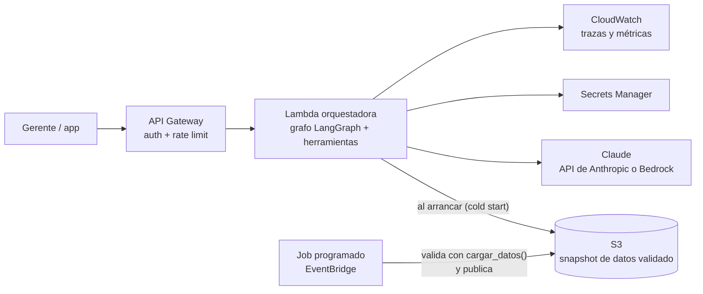

# Cómo lo serviría en producción

Complementa el [README](../README.md): la arquitectura propuesta y cómo bajaría la latencia fuera de esta
versión de prueba.

## Arquitectura

Propuesta, no implementada. La idea es reutilizar lo que ya existe: `responder()`, `cargar_datos()`, las
trazas y el eval.

- **API.** API Gateway con autenticación y rate limit, integrado con una **Lambda que orquesta** el
  agente: corre el grafo de LangGraph y las herramientas, y devuelve lo mismo que `responder()` (texto,
  valor y recomendaciones en JSON). Se despliega como imagen de contenedor a partir del Dockerfile
  actual.
- **Datos.** Al arrancar, la Lambda carga un snapshot versionado desde S3, fuera del handler: tarda unos
  2 segundos y las invocaciones siguientes lo reutilizan. Un job programado arma cada snapshot y lo
  publica solo si pasa las validaciones de `cargar_datos()`. Si una falla, el servicio sigue con el
  snapshot anterior.
- **Modelo y secretos.** La clave va en Secrets Manager. Para quedarse dentro de AWS se puede usar
  Claude en Bedrock cambiando solo `MODELO_LLM`.
- **Observabilidad.** Las trazas que ya se generan van a CloudWatch, con alarmas de latencia, costo por
  pregunta y porcentaje de respuestas con advertencia del verificador. Esa última es la señal de calidad.
- **Deploy.** Los tests offline corren en cada push. Antes de publicar una versión corre `make eval`
  con clave, con `--umbral` como compuerta. Un eval nocturno contra el snapshot de producción detecta
  degradaciones.
- **Límites.** API Gateway corta a los 29 segundos por defecto. Si la latencia medida se acerca a ese
  límite, se pasa a un esquema asíncrono: la API devuelve un ID, la Lambda procesa la pregunta y guarda
  el resultado en DynamoDB. Si el volumen de datos crece, DuckDB lee Parquet desde S3 o se reemplaza por
  un warehouse. Las herramientas mantienen su interfaz, así que el agente no cambia.

## Latencia en producción

Por qué una pregunta tarda unos 4 segundos está en el README ("Latencia: priorizo respuestas confiables
sobre velocidad", en Decisiones de diseño).

En esta versión de prueba hay costos que en producción no estarían:
- cada `make ask` es un proceso nuevo y paga ~2,4 s de arranque (importar LangChain y el SDK de
  Anthropic, y curar los datos), que no entran en la latencia medida;
- todo corre con Sonnet 5.5 y sin streaming, y el cache del prompt solo se aprovecha si las preguntas
  llegan con menos de 5 minutos de diferencia.

En producción se aceleraría así, de mayor a menor impacto:
- **Sin arranque por pregunta:** el modelo y los datos se inicializan una vez, fuera del handler de la
  Lambda (ver [Arquitectura](#arquitectura)). Ahorra ~2,4 s.
- **Recomendaciones precalculadas:** los datos cambian una vez por snapshot, así que el job que publica
  el snapshot puede dejar armado el JSON de recomendaciones de la semana (por cadena y por región). La
  pregunta se responde leyéndolo, sin llamar al modelo.
- **Una sola llamada en recomendaciones:** si hace falta calcularlas en el momento, el código llama a
  `candidatos_visita` directo y el modelo solo redacta. Ahorra una vuelta (~2 s).
- **Cache del prompt siempre caliente:** con tráfico continuo, los ~12k tokens fijos (system más schemas
  de las herramientas) se leen del cache en casi todas las llamadas. Ya está implementado: en el eval
  bajó el costo unas 5,6 veces, pero la latencia casi no cambió (4,1 → 4,0 s), porque el tiempo lo
  domina la generación de la respuesta.
- **Streaming del texto:** el gerente empieza a leer antes de que termine la respuesta. No baja el tiempo
  total, pero sí el tiempo hasta ver algo.
- **Modelo más chico para preguntas simples:** Haiku 5.5 para los conteos y rankings directos, si el eval
  muestra que mantiene los aciertos. Se cambia con `MODELO_LLM`.
- **Menos tokens por llamada:** schemas de herramientas más cortos (`pedidos`, `tasa_quejas` y
  `ranking_sucursales` pesan ~3k caracteres cada uno).
